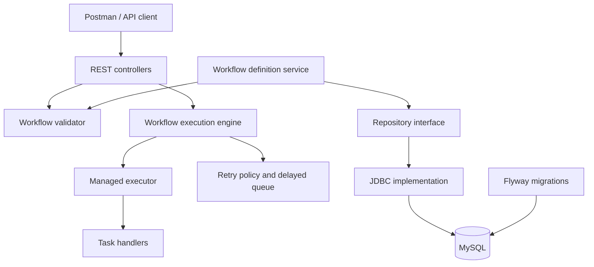
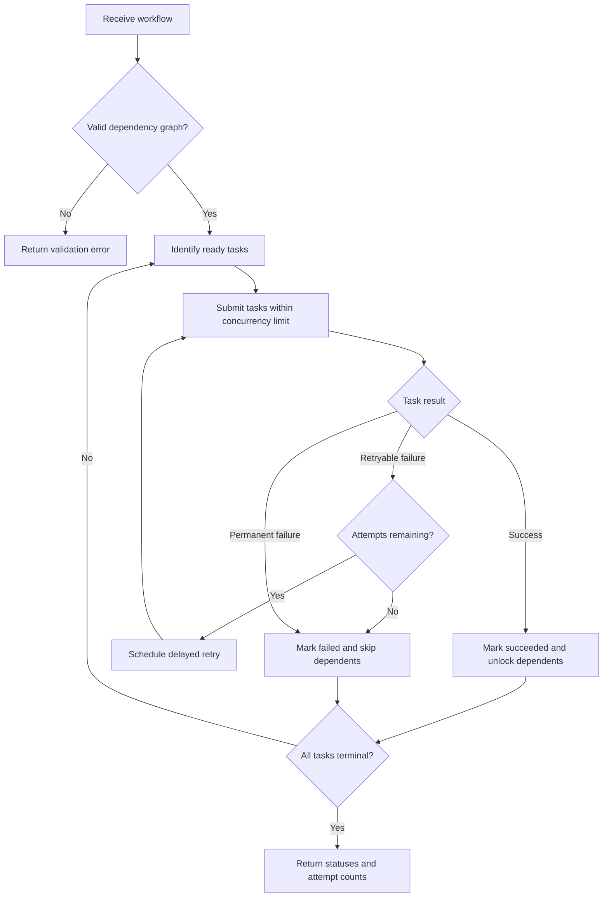

# FlowForge

A Java and Spring Boot workflow engine for validating task dependencies,
executing independent tasks concurrently, and retrying transient failures.

FlowForge is a learning and portfolio project focused on backend engineering:
graph algorithms, Java concurrency, maintainable application design, REST APIs,
and relational persistence.

## Problem Statement

Business processes often contain tasks that must run in a specific order.
Some tasks can run independently, while others must wait for their dependencies.

A workflow engine must answer several questions:

- Are all referenced tasks present?
- Does the dependency graph contain a cycle?
- Which tasks can execute concurrently?
- What happens when a task fails?
- Which failures should be retried?
- How can workflow definitions be stored and retrieved reliably?

FlowForge addresses these questions through dependency validation, bounded
concurrent execution, configurable retry policies, and versioned workflow
definition storage.

## Implemented Features

- Workflow validation for missing dependencies, duplicate task identifiers,
  self-dependencies, and circular dependencies.
- Topological ordering using Kahn’s algorithm.
- Concurrent execution of independent tasks using a Spring-managed executor.
- Dependency-aware scheduling: tasks run only after their dependencies succeed.
- Failure propagation: dependent tasks are skipped after an upstream failure,
  while independent branches can continue.
- Configurable exponential backoff for retryable task failures.
- Delayed retry scheduling using `DelayQueue`.
- Task status and attempt counts in execution results.
- REST endpoints for validation and execution previews.
- MySQL schema management with Flyway.
- Automated tests for validation, execution, retries, REST behavior, and
  database integration.

Execution previews currently use mock task handlers. They do not perform real
payments or call external business services.

## Technology Stack

| Area | Technology |
|---|---|
| Language | Java 21 |
| Backend | Spring Boot |
| REST APIs | Spring MVC, Jakarta Bean Validation |
| Concurrency | ExecutorService, CompletionService, DelayQueue |
| Persistence | MySQL, Spring JDBC |
| Schema migrations | Flyway |
| Testing | JUnit 5, Spring Boot Test, MockMvc |
| Build | Maven Wrapper |
| Manual API testing | Postman |

## Architecture

FlowForge is structured as a modular monolith with responsibilities separated
between the API, application, domain, and persistence layers.



The persistence service is separate from the preview endpoints. Secured
workflow management APIs are planned.

## Execution Flow



## Algorithms and Data Structures

| Component | Purpose |
|---|---|
| Directed dependency graph | Models relationships between workflow tasks |
| Adjacency lists | Track downstream dependent tasks |
| In-degree map | Counts unresolved dependencies |
| ArrayDeque | Holds tasks ready for topological processing |
| Maps | Provide task lookup and track statuses and attempts |
| DelayQueue | Holds retries until their scheduled execution time |

Dependency validation and topological ordering run in **O(V + E)** time,
where V is the number of tasks and E is the number of dependency edges.

## Design Decisions

- **Strategy pattern:** retry behavior is expressed through a retry policy
  interface.
- **Repository pattern:** workflow persistence is accessed through an
  interface, separating application logic from database access.
- **Dependency injection:** Spring manages services and shared infrastructure.
- **Immutable domain records:** workflow definitions are represented using
  records and defensive collection copies.
- **Coordinator-owned execution state:** scheduling decisions and workflow
  state updates are coordinated centrally.
- **Bounded concurrency:** a managed thread pool limits simultaneous task
  execution.
- **Delayed retry scheduling:** workers do not sleep during retry backoff.

## Local Setup

### Requirements

- JDK 21
- MySQL running locally
- Git
- PowerShell or another terminal

Maven is available through the included Maven Wrapper.

### Database Configuration

Create the application and test databases:

- `flowforge`
- `flowforge_test`

Configure local database accounts with access to their respective databases.
The local migration account needs permission to apply the Flyway migrations.

Application database credentials are configured through:

- Username: `flowforge_app`
- Password environment variable: `FLOWFORGE_DB_PASSWORD`

Test database credentials are configured through:

- Username: `flowforge_test_app`
- Password environment variable: `FLOWFORGE_TEST_DB_PASSWORD`

Set the environment variables in the terminal or IntelliJ run configuration.
Do not commit real credentials.

Review these files for local connection settings:

- `src/main/resources/application.properties`
- `src/test/resources/application-test.properties`

Flyway applies database migrations during application startup.
The database and user accounts must already exist.

### Run Tests

From the project root:

```powershell
.\mvnw.cmd clean test
```

Database integration tests require the test database and its credentials.

### Start the Application

```powershell
.\mvnw.cmd spring-boot:run
```

Default application URL:

```text
http://localhost:8082
```

Health endpoint:

```http
GET http://localhost:8082/actuator/health
```

## API Examples

### Validate a Workflow

```http
POST http://localhost:8082/api/workflows/validate
Content-Type: application/json
```

```json
{
  "name": "settlement-preview",
  "tasks": [
    {
      "id": "payments",
      "type": "MOCK_SUCCESS",
      "dependsOn": []
    },
    {
      "id": "reconcile",
      "type": "MOCK_SUCCESS",
      "dependsOn": ["payments"]
    },
    {
      "id": "settlements",
      "type": "MOCK_SUCCESS",
      "dependsOn": ["reconcile"]
    }
  ]
}
```

### Execute a Preview

Send the same JSON body to:

```http
POST http://localhost:8082/api/workflows/execute-preview
Content-Type: application/json
```

The response includes the workflow name, overall success, task statuses,
and execution attempt counts.

### Available Mock Task Types

| Type | Behavior |
|---|---|
| `MOCK_SUCCESS` | Succeeds |
| `MOCK_FAILURE` | Fails without retry |
| `MOCK_RETRYABLE_FAILURE` | Continues failing until retry attempts are exhausted |
| `MOCK_RETRY_THEN_SUCCESS` | Fails on the first two attempts and succeeds on the third |

## Testing Approach

Automated tests cover:

- Valid and invalid dependency graphs.
- Missing tasks, duplicate identifiers, and circular dependencies.
- Dependency-aware execution and concurrent independent tasks.
- Failure propagation and skipped dependent tasks.
- Retry limits and eventual success.
- REST request validation and error responses.
- Application context and database migration checks.

Postman is used to manually exercise workflow validation and execution
preview requests.

## Current Scope and Limitations

- Execution previews run in memory.
- Execution state is not recovered after an application restart.
- Preview admission is limited within one application instance.
- Task handlers simulate outcomes.
- Authentication and authorization are planned.
- This is a local development project, not a production workflow platform.

## Roadmap

- Spring Security and Keycloak JWT authentication.
- Role-based access control.
- Authenticated tenant-scoped workflow management APIs.
- Persistent execution history.
- Additional operational controls and observability.
- CI automation for build and test verification.